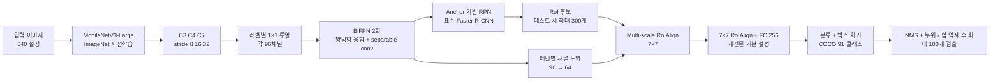

# Lite R-CNN

Lite R-CNN은 Faster R-CNN의 2단계 검출 흐름을 유지하면서, 백본과 특징 융합부, RoI 헤드를 줄여 추론 비용을 낮추려는 이 프로젝트의 모델입니다. 비교 대상은 COCO 사전학습 Faster R-CNN ResNet-50-FPN과 YOLOv26 nano입니다.

모델의 현재 목표는 기존 Faster R-CNN보다 가벼운 구조를 만들고, 정확도 저하와 추론 지연을 실제 측정해 개선 여부를 확인하는 것입니다. COCO mAP 60 이상이나 T4 batch-1 15ms 이하는 목표일 뿐, 아직 달성된 결과가 아닙니다. 전체 진행 상태는 [개발 로드맵](docs/ROADMAP.md)을 참고하십시오.

> 제품·문서 표기는 **Lite R-CNN**을 사용합니다. 기존 Python API와 체크포인트 이름은 호환성을 위해 `LightRCNN`, `light_rcnn`을 사용합니다.

## 현재 구현 구조



### 모델 구성

1. **백본:** torchvision MobileNetV3-Large의 stride 8, 16, 32 특징을 사용합니다. 기본 설정은 ImageNet 사전학습 가중치에서 시작합니다.
2. **특징 융합:** C3/C4/C5를 각각 96채널로 투영한 뒤, 학습 가능한 가중치 융합 BiFPN을 두 번 적용합니다. 융합 합성곱은 depthwise separable convolution입니다.
3. **후보 영역:** Faster R-CNN 표준 Anchor 기반 RPN입니다. 레벨당 3개 크기(16, 32, 64 / 64, 128, 256 / 128, 256, 512)와 3개 종횡비(총 9개)를 사용하여 극소형(16px)부터 대형(512px) 객체까지 커버합니다. 추론 시 RPN 후보는 NMS 전 최대 1,000개, NMS 후 최대 300개입니다.
4. **RoI 헤드:** 기존 10채널 극단적 정보 병목을 해소하기 위해 64채널 투영과 7×7 RoIAlign을 유지하고 단일 FC 256(또는 512)차원 head로 분류 및 박스 회귀를 수행합니다. 학습 시 이미지당 RoI 샘플링 수를 512개(기존 128개)로 상향하여 부분 중복(sub-box) negative 학습을 강화했습니다.
5. **학습 손실 및 후처리:** torchvision Faster R-CNN의 RPN 객체성/박스 손실과 RoI 분류/박스 손실을 사용합니다. 추론 시 NMS 및 부위 중복 억제(containment suppression)를 지원합니다.

따라서 Lite R-CNN은 **Faster R-CNN의 경량 2단계 변형**입니다. 파라미터 수 약 4.3M 수준으로 기존 Faster R-CNN(41.5M) 대비 10배 작으면서도 충분한 표현력을 유지합니다.

## 모델 설계·구현·학습 담당 작업 순서

1. **기준 구조 고정:** `configs/coco.yaml`의 입력 크기, 백본, BiFPN 채널/반복 수, RoI 채널, RPN 후보 수를 실험 설정으로 기록합니다.
2. **학습 가능한 구조 점검:** `src/light_rcnn/model/layers.py`와 `detector.py`에서 특징 맵 크기와 RoI 출력 차원을 확인합니다. 클래스 ID 및 COCO annotation 매핑은 Faster R-CNN과 일치시킵니다.
3. **지도학습 기준 모델:** 지식 증류 없이 COCO로 먼저 학습해 학습 손실과 검증 AP가 정상인지 확인합니다. 기본 학습 증강은 RGB 입력 정규화와 train 전용 확률 0.5 좌우 반전이며, validation은 원본 이미지로 평가합니다. 작은 subset은 파이프라인 점검에만 사용하고 최종 성능으로 보고하지 않습니다.
4. **최적 체크포인트 선택:** 매 검증 주기마다 COCO AP@[.50:.95]를 계산합니다. `last.pth`는 재개용, `best.pth`는 최고 검증 AP 모델입니다.
5. **증류 실험:** 지도학습 결과를 기준으로 Faster R-CNN ResNet50-FPN 교사를 이용한 feature/RoI 지식 증류를 별도 실행합니다. 증류가 정확도를 높이는지 검증 전후 AP로 비교합니다.
6. **효율 조정:** 백본/피라미드 폭, RoI 채널 수, 이미지 크기와 RPN proposal 수를 하나씩 조정하고, AP·파라미터·FLOPs·p50/p95 지연 시간을 함께 기록합니다.

학습 재개, 손실 기록, 증류 실행 방법은 [학습 안내](docs/TRAINING.md)에 있습니다. 지식 증류는 기본값에서 꺼져 있으며 `--distill` 또는 분류 전용 실험의 `--distill-roi-only`로 켭니다. 교사는 학습 중에만 사용하고 Lite R-CNN 추론 모델에는 포함되지 않습니다.

Lite R-CNN 내부 설계 ablation과 COCO 결과는 [실험 기록](docs/EXPERIMENT_LOG.md)에 정리합니다.

## 설치 및 데이터

프로젝트는 Python 3.10 이상이 필요합니다. 새 환경은 다음처럼 만들 수 있습니다.

```powershell
py -3.12 -m venv .venv
.\.venv\Scripts\Activate.ps1
python -m pip install -e ".[train,export,compare-yolo,dashboard,huggingface]"
```

기존 Python 3.12 환경 `.venv312`를 사용하는 경우에는 다음 명령으로 활성화합니다.

```powershell
.\.venv312\Scripts\Activate.ps1
```

COCO 2017 데이터는 아래 구조로 둡니다.

```text
data/coco/
├── images/
│   ├── train2017/
│   └── val2017/
└── annotations/
    ├── instances_train2017.json
    └── instances_val2017.json
```

사용할 COCO 2017 파일은 [Hyeon1222/COCO](https://huggingface.co/datasets/Hyeon1222/COCO)에서 준비할 수 있습니다. Hugging Face Hub 추가 의존성을 설치한 다음, 저장소 루트에서 실행하면 ZIP을 내려받고 압축을 풀어 위 구조로 배치합니다.

```powershell
python -m pip install -e ".[huggingface]"
python scripts/prepare_hf_coco.py
```

기본 실행은 train, validation 이미지와 annotation을 모두 준비합니다. 전체 다운로드는 약 20 GB의 ZIP이며 압축 해제 공간도 별도로 필요합니다. 먼저 일부 split만 받을 수 있습니다. 예를 들어 `--splits annotations val`은 검증용 이미지와 annotation만 준비합니다. ZIP은 기본적으로 `data/hf_cache/`에 남아 재실행 때 재사용되며, 압축 해제가 끝난 뒤 삭제해도 됩니다.

```powershell
python scripts/prepare_hf_coco.py --splits annotations val
```

데이터 준비가 끝나면 아래 학습 명령이 같은 경로에서 동작합니다.

정확도 평가와 학습에는 이미지뿐 아니라 해당 split의 annotation JSON도 필요합니다. 단일 공통 이미지로 가능한 것은 모델 추론 확인과 지연 시간 측정이며, mAP는 계산할 수 없습니다.

## 학습 및 비교 실행

전체 COCO 학습은 RTX 4090 등 CUDA GPU에서 진행하는 것을 권장합니다. 기본 `configs/coco.yaml`은 CUDA, batch size 8, AMP를 사용하며, CPU 설정은 파이프라인 확인이나 작은 실험용입니다. CPU 처리량으로 추정한 전체 학습 시간은 약 70일 이상이므로 전체 학습에는 사용하지 마십시오.

COCO 준비, Lite R-CNN 학습, epoch별 COCO 검증과 연구 기록 갱신을 반복하는 자동 연구 실행기는 아래 파일입니다. 이 실행기는 선택 사항이며 기본 CPU 설정을 사용합니다.

```powershell
.\start_lite_rcnn_research.ps1
```

탐색기에서 실행하려면 `start_lite_rcnn_research.bat`을 사용할 수 있습니다. 기본은 CPU preset이며, 연구 루프는 학습률과 seed를 바꿔 연속 실행합니다. 전체 GPU 학습을 직접 시작하려면 아래 RTX 4090 명령을 사용하십시오. 중간에 멈추면 마지막 완료 epoch 체크포인트에서 재개할 수 있습니다.

```powershell
python scripts/train.py --config configs/coco.yaml --device cuda --epochs 36 --output-dir outputs/coco_4090
```

RTX 4090 환경에서는 CUDA 지원 PyTorch/torchvision을 설치한 뒤 `python -c "import torch; print(torch.cuda.is_available(), torch.cuda.get_device_name(0))"`로 장치를 확인하십시오. 데이터가 `data/coco/`에 있고 네 경로가 모두 존재하는지 확인한 다음 위 학습 명령을 실행합니다. 기본 설정은 batch size 8과 AMP를 사용합니다. 메모리 부족이면 `configs/coco.yaml`의 batch size를 낮추고 새 output directory를 지정하십시오. 이어 학습은 `python scripts/train.py --resume outputs/coco_4090/last.pth --epochs 36`입니다. `--epochs`는 총 목표 epoch 수입니다.

먼저 파이프라인만 짧게 확인하려면 COCO 데이터를 준비한 뒤 일부 이미지로 실행합니다. 이 체크포인트의 AP는 부분 데이터 기준이므로 최종 성능으로 사용하면 안 됩니다.

```powershell
python scripts/train.py --config configs/coco_cpu.yaml --device cpu --epochs 2 --train-limit 16 --val-limit 16 --output-dir outputs/coco_cpu_smoke
```

학습이 끝나면 `outputs/coco_cpu/best.pth`가 검증 AP 기준 최적 가중치입니다. 세 모델을 CPU에서 비교하려면 다음처럼 실행합니다.

```powershell
python scripts/run_comparison.py --device cpu --light-weights outputs/coco_cpu/best.pth
```

동일한 이미지 한 장으로 지연 시간만 미리 확인할 수 있습니다. Lite R-CNN 체크포인트가 없으면 ImageNet 사전학습 백본과 초기화된 검출 헤드로 속도만 측정하며, 그 예측 결과나 정확도는 비교하지 않습니다.

```powershell
python scripts/run_comparison.py --device cpu --inference-only --source data/samples/test.jpg
```

`--inference-only`는 COCO annotation이 필요하지 않습니다. 단일 이미지는 동작 점검용입니다. 의미 있는 지연 시간 분포를 위해서는 같은 해상도·조건의 이미지 여러 장을 `--source` 폴더에 넣어 사용하십시오. 전체 비교 실행은 단계 중 하나라도 실패하면 중단되며 결과를 `outputs/comparison_runs/`의 해당 실행 폴더에 저장합니다.

## 비교 프로토콜

성능 측정 담당자와 데이터셋 담당자는 세 모델에 동일한 COCO split과 이미지 집합을 사용하고, 입력 크기 640, batch size 1, 장치와 정밀도를 기록합니다. 각 프레임워크의 resize/padding 방식은 다를 수 있으므로 설정도 함께 남깁니다.

최종 비교표에는 다음 항목을 기록합니다.

| 항목 | 설명 |
| --- | --- |
| AP@[.50:.95], AP50, AP75 | COCO bbox 정확도; 검증 annotation 필요 |
| 파라미터 수, FLOPs | 모델 크기와 연산량 |
| p50/p95 latency | batch-1 지연 시간 분포; 예열 및 측정 반복 수 기록 |
| 측정 조건 | GPU/CPU, FP32/FP16, 입력 크기, 전처리·후처리 포함 범위 |

일반 PyTorch CPU 측정은 NVIDIA T4 TensorRT 성능을 대신하지 않습니다. TensorRT 변환, NMS 시간 분리, 실제 T4 성능은 별도의 배포 단계에서 확인해야 합니다.

## 현재 상태와 제한

- 모델 구조, COCO 학습/검증, best/last 저장, 학습 재개와 선택형 지식 증류 코드가 있습니다.
- 학습된 COCO Lite R-CNN 가중치와 검증된 전체 COCO/T4 성능 수치는 아직 없습니다.
- CPU 합성 데이터 통합 테스트가 구현되어 있지만, 실제 정확도 향상은 COCO 학습 결과로 확인해야 합니다.
- ONNX 내보내기 진입점은 있으나 TensorRT에서 RoIAlign/NMS를 포함해 동작하는지와 FP16/INT8 정확도는 검증이 필요합니다.
- 대시보드 코드는 [dashboard/app.py](dashboard/app.py)이며 평가 JSON과 지연 시간 JSON을 읽습니다.
