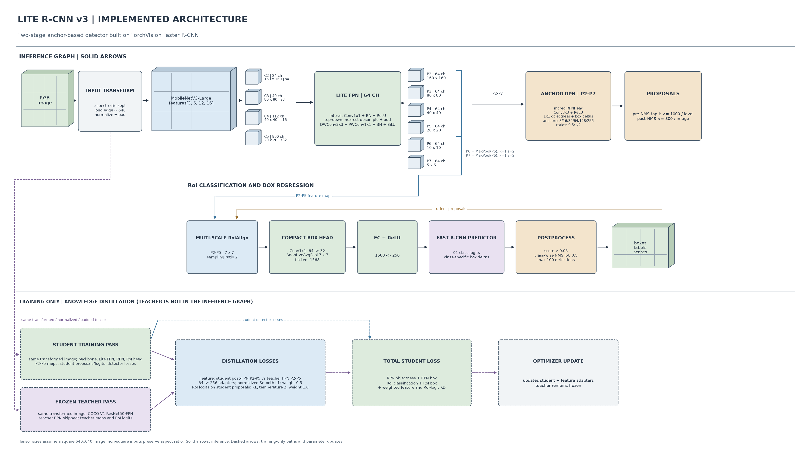

# Lite R-CNN v3: Implementation and Experiment Record

> This document describes the implementation in this repository and the experiments recorded with it. It does not replace source code. Each technical section links to the code or artifact that supports it. Unknown run details are stated as unrecorded rather than inferred.

## 1. Model identity

Lite R-CNN v3 is implemented as `LightRCNNV3`, a subclass of TorchVision's `FasterRCNN`. It retains the two-stage flow: an anchor-based Region Proposal Network (RPN) proposes regions, and an RoI head classifies and refines those regions. The project-specific changes are its MobileNetV3-Large backbone, single-pass Lite FPN, six-level RPN pyramid, and compact RoI head. It is not anchor-free. ([v3 model](../../src/light_rcnn/model/v3.py), [v2/baseline helpers](../../src/light_rcnn/model/detector.py))

## 2. Python environments and execution context

### 2.1 RTX 4090 training run

The saved v3 run report records an NVIDIA GeForce RTX 4090, PyTorch `2.7.1+cu128`, and CUDA runtime `12.8`. It does **not** record the Python or TorchVision version. The training environment's Python version therefore cannot be stated from the archived run files. ([run report](../../outputs/coco_4090_v3/RESULTS.md))

### 2.2 Current local development environment

The local `.venv312` probe recorded Python `3.12.14`, PyTorch `2.14.1+cpu`, and TorchVision `0.29.1+cpu`; selected local package versions are documented separately. The `.venv` interpreter is Python `3.6.8` and has no PyTorch installed; it does not satisfy this project's `requires-python >=3.10` declaration. Ultralytics `8.4.177` is installed locally for the separate YOLO comparison, but v3 itself is built with PyTorch/TorchVision and does not use Ultralytics. These local versions are not the RTX 4090 training versions. ([local environment snapshot](ENVIRONMENT_SNAPSHOT.md), [project dependencies](../../pyproject.toml))

The project declares PyTorch `>=2.2`, TorchVision `>=0.17`, NumPy `>=1.26`, PyYAML `>=6.0`, Pillow `>=10.0`, and tqdm `>=4.66`. Optional groups add `pycocotools` for training/evaluation, ONNX tools for export, Ultralytics for YOLO comparison, Streamlit/Plotly/Pandas for the dashboard, and Matplotlib for visualizations. The package manifest gives minimum versions, not an exact lockfile. ([pyproject.toml](../../pyproject.toml))

## 3. Input and preprocessing

The COCO loader reads an image, converts it to RGB, and returns a float tensor with values in `[0, 1]`. It drops crowd annotations and non-positive-width/height boxes; remaining COCO `xywh` boxes become `xyxy` float targets, retaining COCO category IDs. During training, horizontal flips also update the target boxes. v3 config sets `image_size: 640`; the model passes `min_size=max_size=640` to TorchVision's detection transform. This preserves aspect ratio and resizes the long edge to approximately 640 pixels; it does not stretch every image to a square. TorchVision pads batched images to its size-divisibility requirement. The model constructor does not override TorchVision's image mean/std defaults. ([COCO loader](../../src/light_rcnn/data.py), [v3 config](../../configs/coco_v3.yaml), [v3 constructor](../../src/light_rcnn/model/v3.py))

For a square 640×640 example, the feature map sizes below are exact. For non-square images, spatial shapes vary with the aspect ratio and padding.

## 4. Inference architecture, layer by layer



### 4.1 Backbone: MobileNetV3-Large

The model factory can request TorchVision `MobileNet_V3_Large_Weights.DEFAULT`. For the recorded v3 training run, however, `train.py` disabled that separate pretrained fetch because `--init-backbone` was supplied; it loaded the compatible MobileNetV3 feature extractor tensors from the v2 checkpoint instead. v3 taps the `.features` sequence at indices `3`, `6`, `12`, and `16` to produce C2-C5. The code records channel counts `(24, 40, 112, 960)` and strides `(4, 8, 16, 32)`. On a square 640 input, these are respectively `24×160×160`, `40×80×80`, `112×40×40`, and `960×20×20`. ([backbone code](../../src/light_rcnn/model/v3.py), [initialization code](../../scripts/train.py), [saved run config](../../outputs/coco_4090_v3/config.yaml))

The project delegates MobileNetV3-Large's internal blocks to TorchVision; it does not rewrite them. The main diagram therefore treats the dependency as one backbone module and labels the four tensors the project actually taps. For a layer-level reference, the table below lists the `features` sequence in the separately probed local TorchVision `0.29.1+cpu` implementation. TorchVision and Python versions for the RTX 4090 training run were not recorded, so this local table is not asserted as proof of the exact library build used for that run. In the table, `RE` means ReLU, `HS` means Hardswish, and `SE` means squeeze-and-excitation. An InvertedResidual block uses expansion (omitted when expansion width equals input width), depthwise convolution, optional SE, and pointwise projection; its residual is used only when stride and channels allow it. ([TorchVision MobileNetV3 source, v0.29.1](https://github.com/pytorch/vision/blob/v0.29.1/torchvision/models/mobilenetv3.py), [local environment snapshot](ENVIRONMENT_SNAPSHOT.md))

| `features` index | TorchVision block configuration | Project output tap for square 640 input |
|---:|---|---|
| 0 | Stem Conv-BN-HS, 3→16, 3×3/stride 2 | — |
| 1 | InvertedResidual, 16→16→16, 3×3/stride 1, no SE, RE | — |
| 2 | InvertedResidual, 16→64→24, 3×3/stride 2, no SE, RE | — |
| 3 | InvertedResidual, 24→72→24, 3×3/stride 1, no SE, RE | **C2:** 24×160×160, stride 4 |
| 4 | InvertedResidual, 24→72→40, 5×5/stride 2, SE, RE | — |
| 5 | InvertedResidual, 40→120→40, 5×5/stride 1, SE, RE | — |
| 6 | InvertedResidual, 40→120→40, 5×5/stride 1, SE, RE | **C3:** 40×80×80, stride 8 |
| 7 | InvertedResidual, 40→240→80, 3×3/stride 2, no SE, HS | — |
| 8 | InvertedResidual, 80→200→80, 3×3/stride 1, no SE, HS | — |
| 9 | InvertedResidual, 80→184→80, 3×3/stride 1, no SE, HS | — |
| 10 | InvertedResidual, 80→184→80, 3×3/stride 1, no SE, HS | — |
| 11 | InvertedResidual, 80→480→112, 3×3/stride 1, SE, HS | — |
| 12 | InvertedResidual, 112→672→112, 3×3/stride 1, SE, HS | **C4:** 112×40×40, stride 16 |
| 13 | InvertedResidual, 112→672→160, 5×5/stride 2, SE, HS | — |
| 14 | InvertedResidual, 160→960→160, 5×5/stride 1, SE, HS | — |
| 15 | InvertedResidual, 160→960→160, 5×5/stride 1, SE, HS | — |
| 16 | Final Conv-BN-HS, 160→960, 1×1/stride 1 | **C5:** 960×20×20, stride 32 |

The tap names C2-C5 above follow this project's backbone code/docstring and denote the selected stride-4/8/16/32 tensors; they should not be read as TorchVision's internal comments for its bottleneck configuration.

### 4.2 Neck: project-defined Lite FPN

The `LiteFeaturePyramid` is a project implementation, not a separate TorchVision module. It performs one top-down pass. Each C2-C5 tensor first passes through a lateral `1×1 Conv2d → BatchNorm2d → ReLU` projection to 64 channels. Higher-level features are nearest-neighbor upsampled and added to the next lower lateral feature. Each merged output then passes through `SeparableConv`: depthwise `3×3` convolution (`groups=64`), pointwise `1×1` convolution, batch normalization, and SiLU. These outputs are P2-P5, each 64 channels. ([Lite FPN](../../src/light_rcnn/model/v3.py), [separable convolution](../../src/light_rcnn/model/layers.py))

P6 is produced by `MaxPool2d(kernel_size=1, stride=2)` on P5; P7 is produced by the same operation on P6. P2-P5 are used by both RoIAlign and RPN; P6-P7 are RPN-only. For square 640 input, the nominal sizes are P2 160×160, P3 80×80, P4 40×40, P5 20×20, P6 10×10, and P7 5×5. ([backbone forward](../../src/light_rcnn/model/v3.py))

### 4.3 Anchor-based RPN

The RPN consumes P2-P7. Its six anchor-size groups are `[8]`, `[16]`, `[32]`, `[64]`, `[128]`, and `[256]` pixels. Each level uses aspect ratios `0.5`, `1.0`, and `2.0`, giving three anchors per location at each level. The implementation uses TorchVision `RPNHead` with 64 input channels. ([v3 config](../../configs/coco_v3.yaml), [RPN construction](../../src/light_rcnn/model/v3.py))

At inference, RPN pre-NMS top-k is up to 1,000 candidates **per feature level**; after proposal NMS, up to 300 proposals per image are returned. During training, the configured limits are 2,000 before NMS per level and 1,000 after NMS per image. These are proposal counts, not the final number of detected objects. ([RPN limits](../../src/light_rcnn/model/v3.py), [TorchVision RPN filtering](https://github.com/pytorch/vision/blob/main/torchvision/models/detection/rpn.py))

### 4.4 RoIAlign and compact box head

TorchVision `MultiScaleRoIAlign` pools proposals from P2-P5 into `7×7` features with `sampling_ratio=2`. The box head then applies a `1×1 Conv2d` projection from 64 to 32 channels, adaptive average pooling to `7×7`, flattening (`32×7×7 = 1,568` values), and a `Linear(1,568→256)` plus ReLU. ([RoI construction](../../src/light_rcnn/model/v3.py), [box head](../../src/light_rcnn/model/detector.py))

The TorchVision `FastRCNNPredictor` emits 91 class logits and class-specific box-regression outputs with 91 four-value slots. The 91 class slots follow the COCO category-ID space and include background; COCO has 80 foreground categories. ([predictor construction](../../src/light_rcnn/model/v3.py), [class count](../../configs/coco_v3.yaml))

### 4.5 Inference filtering

The model's configured detection score threshold is `0.05`; class-wise box NMS uses IoU `0.5`; and the model returns at most 100 detections per image. These settings are not the same as the later display threshold in `predict.py`: that script defaults to `--score-threshold 0.25` and also applies its own overlap/containment filtering. The evaluation script's custom Precision/Recall calculation applies score `≥0.5` and class-aware greedy IoU `≥0.5`; those metric thresholds do not change the model's stored weights. ([v3 config](../../configs/coco_v3.yaml), [predict script](../../scripts/predict.py), [P/R calculation](../../scripts/evaluate_three_models_gpu_full.py))

COCO AP is evaluated with `COCOeval` for bounding boxes over IoU thresholds `.50:.05:.95`; it is not a single fixed-confidence result. The repository does not calculate a statistical p-value. ([COCO evaluator](../../src/light_rcnn/evaluation.py))

### 4.6 Explicit settings and inherited TorchVision defaults

The v3 constructor/config explicitly sets the image-size limits, anchor scales/ratios, train/test proposal top-k limits, RoI sample count, score threshold, box NMS IoU, and maximum detections described above. It does not override every Faster R-CNN option: RPN/box matching thresholds, sampler fractions and some box-coder/transform details are inherited from the installed TorchVision implementation. The saved RTX run does not record its TorchVision version, so this guide does not assign unverified inherited numeric defaults to that run. The local environment snapshot gives the separate development environment version. ([v3 constructor](../../src/light_rcnn/model/v3.py), [local environment snapshot](ENVIRONMENT_SNAPSHOT.md), [saved run report](../../outputs/coco_4090_v3/RESULTS.md))

## 5. Training and knowledge distillation

### 5.1 Student initialization and training recipe

The saved v3 config records initialization type `mobilenet_v3_backbone_only` from `outputs/coco_4090_v2/best.pth`. The training code copies shape-compatible tensors under `backbone.body.features.*`; it does not initialize the v3 neck, RPN, or RoI head from v2. ([saved initialization](../../outputs/coco_4090_v3/config.yaml), [initialization code](../../scripts/train.py))

The run used COCO 2017 with 118,287 training images and all 5,000 validation images. Configured values: 48 epochs, batch size 4, validation batch size 4, 8 workers, input size 640, mixed precision enabled on CUDA, seed 42, horizontal-flip probability 0.5, AdamW learning rate `1e-4`, weight decay `1e-4`, 1,000 warmup steps, learning-rate milestones at 32 and 42 with gamma `0.1`, gradient-norm clipping at 10, and 512 RoI samples per image. Because the scheduler steps per batch, the recorded learning-rate drops first appear in epochs 33 and 43. No train/validation subset limit was configured. ([v3 config](../../configs/coco_v3.yaml), [training loop](../../scripts/train.py), [run report](../../outputs/coco_4090_v3/RESULTS.md), [epoch history](../../outputs/coco_4090_v3/history.jsonl))

### 5.2 Teacher and student paths

The frozen teacher is TorchVision COCO_V1 Faster R-CNN ResNet50-FPN. During a training batch, the student performs its normal transform, backbone, RPN, proposal sampling, RoI pooling, and prediction. The teacher receives the student's already normalized, resized, and padded image tensor under `no_grad`; it is kept in evaluation mode. The teacher RPN is not run. The teacher RoI head receives the student's sampled proposals. ([teacher/trainer implementation](../../src/light_rcnn/distillation.py))

Two auxiliary losses are added:

1. **Feature loss:** the tensors selected by the v3 distillation keys are the **post-Lite-FPN student P2-P5 outputs**, paired with the teacher's corresponding FPN feature maps at strides 4, 8, 16, and 32. Four trainable `1×1` adapters map student channels `64→256`. Teacher maps are bilinearly resized to student spatial dimensions; channel-normalized features are compared with Smooth L1, and the four level losses are averaged. The configured feature-loss weight is `0.5`.
2. **RoI-logit loss:** teacher and student class logits are computed for the same student-sampled RoIs. KL divergence compares temperature-scaled distributions at temperature `2.0`; the implementation multiplies the KL term by temperature squared and the configured loss weight `1.0`. Teacher box-regression outputs are not distilled. ([distillation key mapping and losses](../../src/light_rcnn/distillation.py), [v3 feature names](../../src/light_rcnn/model/v3.py), [weights](../../configs/coco_v3.yaml))

The total training loss is the sum of the student's RPN objectness, RPN box-regression, RoI classification, and RoI box-regression losses plus the two weighted distillation losses. The teacher is frozen; gradients update the student and feature adapters. The v3 `history.jsonl` contains both `loss_kd_feature` and `loss_kd_roi` from epoch 1, confirming that distillation was active in the recorded run. ([training loss sum](../../scripts/train.py), [history](../../outputs/coco_4090_v3/history.jsonl))

### 5.3 What the experiment can establish

The distillation-enabled v3 run completed 48/48 epochs. Its training-run validation best checkpoint is epoch 42 at AP@[.50:.95] `26.80%`, AP50 `48.02%`, AP75 `26.84%`, using validation batch size 4. Epoch 48 AP@[.50:.95] was `26.76%`. ([run report](../../outputs/coco_4090_v3/RESULTS.md))

The run report identifies code revision `9465b59` and marks the worktree dirty. The archived files therefore do not prove that the current source tree is byte-for-byte identical to every source file used for that run; implementation descriptions here are traced to the checked-out source, while metrics are attributed to the saved run artifacts. ([run report](../../outputs/coco_4090_v3/RESULTS.md))

A separate standardized batch-size-1 GPU evaluation used 5,000 COCO val2017 images and recorded AP@[.50:.95] `26.1126%`, AP50 `47.1540%`, AP75 `26.2893%`, Precision `66.8713%`, and Recall `46.1704%`. In that run, Precision/Recall use score `≥0.5` and class-aware greedy IoU `≥0.5`; AP follows COCO evaluation. The CPU evaluation used a 1,000-image subset and is a separate measurement. Do not compare these AP values as if they came from identical evaluation batches and image counts. ([GPU run](../../outputs/evaluation_runs/20261101_053245/evaluation.json), [CPU run](../../outputs/evaluation_runs/20261101_054559/evaluation.json), [metric definition](../../scripts/evaluate_three_models_gpu_full.py))

The recorded parameter count is 3,622,918 (`3.623M`). The FP32 model-state size is approximately `13.82 MB`; the checkpoint file is approximately `42.61 MB` because it contains more than the raw FP32 model tensors. GPU batch-size-1 latency in the standardized 5,000-image run was p50 `5.91 ms` and p95 `6.62 ms`. ([GPU evaluation artifact](../../outputs/evaluation_runs/20261101_053245/evaluation.json))

The artifacts prove that this v3 run used distillation and show its final metrics. They do not isolate how much of the score is caused by distillation; that claim would require a matched v3 training run with the same architecture, data, schedule, and seed but KD disabled.

## 6. Reproduction commands

The saved training run used CUDA. On another computer, activate a CUDA-capable Python environment satisfying `pyproject.toml` first, then run this from the repository root. The local `.venv312` snapshot in this workspace contains CPU-only PyTorch, so it cannot execute this CUDA training command as written.

```bash
python scripts/train.py --config configs/coco_v3.yaml --device cuda --init-backbone outputs/coco_4090_v2/best.pth
```

For image-folder prediction with a saved v3 checkpoint, `scripts/predict.py` accepts a source file or directory. Set `--score-threshold` explicitly when the display cutoff must match a comparison setting; its default is 0.25. It is a prediction/visualization script, not the COCO AP evaluator. ([predict script](../../scripts/predict.py))

## 7. Source-backed layer inventory

| Stage | Implemented components | Main outputs |
|---|---|---|
| Transform | RGB tensor, TorchVision resize/normalize/pad | resized image tensor |
| Backbone | MobileNetV3-Large feature taps at indices 3/6/12/16 | C2-C5; 24/40/112/960 channels |
| Neck | Four Conv1×1-BN-ReLU lateral projections; top-down nearest upsample/add; four depthwise-separable output blocks | P2-P5, 64 channels |
| RPN-only levels | two `MaxPool2d(k=1,s=2)` operations | P6/P7 |
| RPN | anchor generator + TorchVision RPN head | objectness, box deltas, proposals |
| RoI pooling | multi-scale RoIAlign on P2-P5, 7×7, sampling ratio 2 | 64×7×7 RoI tensors |
| Box head | Conv1×1 64→32; adaptive average pool 7×7; flatten; FC 1568→256; ReLU | 256-D RoI representation |
| Predictor | FastRCNNPredictor | 91 class logits and class-specific box outputs |
| Postprocessing | score threshold 0.05; class-wise NMS 0.5; max 100 detections | boxes, labels, scores |

All table entries are in [`v3.py`](../../src/light_rcnn/model/v3.py), [`detector.py`](../../src/light_rcnn/model/detector.py), [`layers.py`](../../src/light_rcnn/model/layers.py), and [`coco_v3.yaml`](../../configs/coco_v3.yaml).
